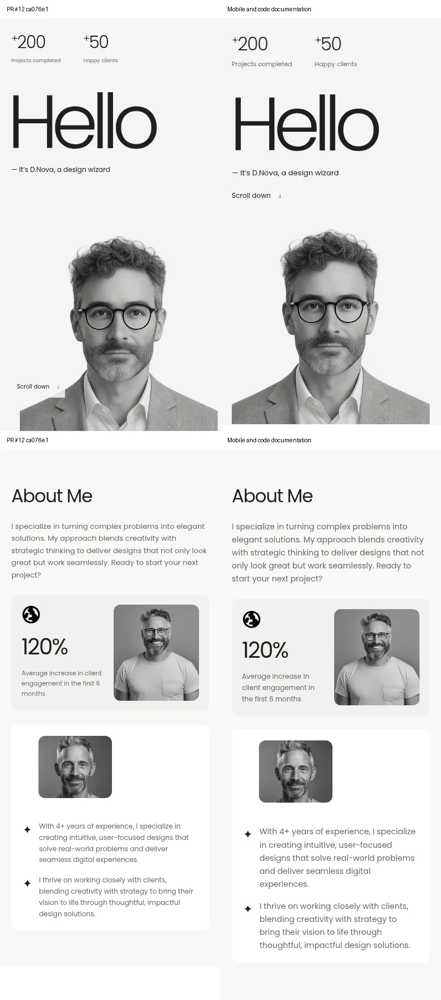
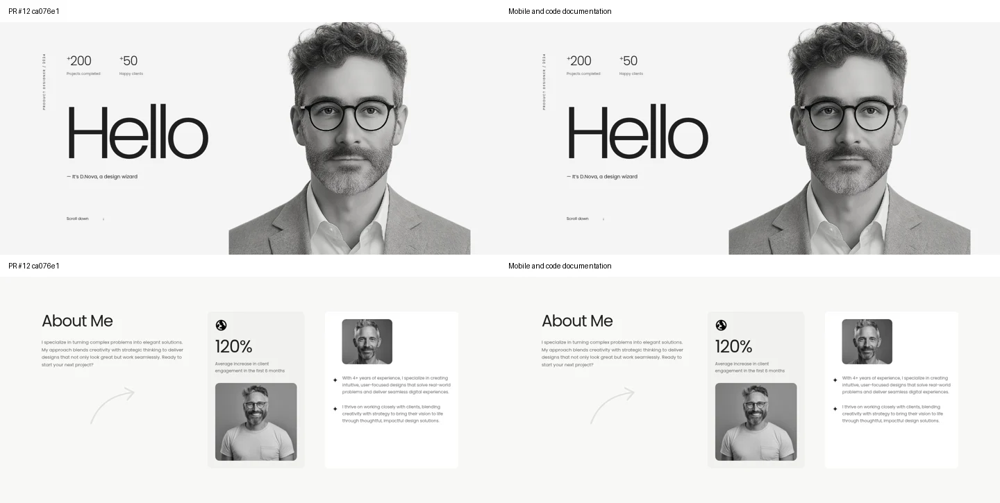

# Koodin dokumentointi, mobiili ja Figma — 11.11.2026

[PR #12](https://github.com/MiroKur/WEB-sivut-projekti/pull/12) · [Opiskelijan koodiopas](docs/CODE-GUIDE.md) · [Figma Design](https://www.figma.com/design/CAn1NxX7vfOdixPIUFJRV7?node-id=7-87) · [Mobiiliprototyyppi](https://www.figma.com/proto/CAn1NxX7vfOdixPIUFJRV7?node-id=7-87&starting-point-node-id=7%3A87&scaling=scale-down)

## Lähtötilan varmistus

PR #12 oli avoin, head `ca076e111bfe2c32e08dd3e683c201bdc24254f2`; työpuu oli puhdas ja originin haara vastasi sitä. Työ jatkuu samalla `feat/portfolio-final-interactions`-haaralla: ei toista ristiriitaista toteutushaaraa, eikä mainia yhdistetä automaattisesti.

Ennen muutoksia PR:n oma Playwright-tarkistin ajettiin onnistuneesti 320/390/768/1024/1440 px leveyksillä. Se varmisti kuvat ja fontit, hero-laskurit/parallaxin/Hello-animaation reduced motion -tilan, karusellin ja sen rullaohjauksen/reunat, accordionin, blogit, valikon, Winter Deal -sisällön mahtumisen ja näppäimistön. Lähtötilan kuvakaappaukset otettiin. Ensimmäinen palvelinyhteys oli vanhentunut; oma paikallinen palvelin käynnistettiin porttiin 5501 ja testit toistettiin sitä vasten.

## Koodin kommentointi ja siivous

- `index.html` pysyy yhtenä one-page-sivuna. Kaikilla kymmenellä osiolla on selittävä suomenkielinen pääkommentti. Sisäiset kommentit avaavat kuvasäiliöt, ankkurit, JS-tunnisteet, natiivin details/summaryn, lazy loadingin ja koristeiden aria-hidden/alt-käytön.
- `script.js` on jaettu kommenttiotsikoilla toimintoihin. Kommentit selittävät matchMedian, osoitinehdot, koordinaattien normalisoinnin, request/cancelAnimationFramen, IntersectionObserverin, laskurien ease-outin, scroll-mitat, range-ohjauksen ja rajatun preventDefault-käytön. Varsinaisia vanhoja toimintoja ei korvattu.
- `styles.css` on koottu 13 loogiseen ryhmään. Täsmälleen samojen perustyyliselektorien myöhemmät ylikirjoitukset yhdistettiin, saman mediaehdon säännöt koottiin ja käyttämättömiä vanhoja client-label/suoran blogikuvan sääntöjä poistettiin. Mobiilissa samat selectorit koottiin yhdeksi kokonaisuudeksi. Väri- ja välitokenit vastaavat myös Figmaa.
- Ennen mobiilimuutoksia selaimen laskettuja asettelu-, väri- ja typografiatyylejä verrattiin lähtötilaan kaikille body-elementeille **kahdeksalla leveydellä**: ei eroja. Mobiilimuutosten jälkeen 768/1024/1440 px vertailu säilyi identtisenä näille mitatuille tyyleille. Tämä on rajattu regressiotarkistus, ei väite alkuperäisen Wolfpixel-mallin pikselintarkasta vastaavuudesta.
- Uusi [CODE-GUIDE.md](docs/CODE-GUIDE.md) selittää toteutuksen opiskelijalle ja antaa ohjeet värien, kuvien, tekstien, laskurien ja animaatioasetusten muuttamiseen.

## Mobiilin oma sommittelu

Lähtöleveys 390 px, tarkistukset myös 320/360/375/430 px. Desktopin toteutusta ei rakennettu uudelleen.

| Alue | Muutos ja ero desktopiin |
| --- | --- |
| Header | Tunnuksen kosketusalue 44 × 44 px, selkeämpi 14 px Menu, vähintään 44 px toimintokohteet ja 48 px valikkolinkit. Kolme pääryhmää mahtuvat myös 320 px leveydelle. |
| Hero | Oma pystysuuntainen Grid: teksti ja Scroll down ennen normaalissa virrassa olevaa henkilökuvaa. Kiinteä 730 px minimikorkeus ja scroll-linkin 608 px top poistettiin mobiilissa. Kuva ei peitä tekstiä. |
| About | Kolme pääpalstaa muuttuvat pinoksi; tilastokortin sisällä kaksi palstaa. Esittely- ja lisätekstit 14 px, kortin kuvaus 12 px. |
| Showcase | Selaimen oma vaakapyyhkäisy ja snap säilyvät. Otsikko ja logo ovat omilla riveillään; seuraavan kortin reuna antaa vihjeen. |
| Experiences | Nimi, aika, rooli ja tagit näkyvät mobiilissakin. Rooli on omalla rivillään, plus oman kapean palstansa yläreunassa. |
| Winter Deal | Kaikki neljä tekstiosaa säilyvät; otsikko käyttää mobiilin clamp-arvoa ja kuvaus on luettavampi. |
| Latest Works / blogit | Yksi pääkortti per rivi, oikeat kuvasuhteet ja logot. Read insight on 14 px ja toimii napautuksella. |
| Contact / footer | Suuremmat tekstit ja linkit, sähköpostin joustava fonttikoko sekä rivittyminen. Piilotettavan br-elementin ympärille lisättiin puuttuva välilyönti, jotta sanat eivät yhdisty; sama Winter Deal -otsikossa. |

Hero-parallax jää pois kosketusosoittimella. Laskurit ja reduced motion -käytös säilyvät. Mobiilille ei lisätty erillistä HTML-tiedostoa, frameworkia tai wheel-simulaatiota.

## Testit ja visuaalinen tarkistus

Nykyinen `tests/browser-check.cjs` laajennettiin kaikille leveyksille: **320, 360, 375, 390, 430, 768, 1024 ja 1440 px**. Kaikki läpäisty Chromiumilla.

Tarkistukset: ei dokumentin vaakaylivuotoa, kuvat/alt/width/height ja paikalliset fontit latautuvat, nuoliympyrät säilyvät, range toimii Home/End-näppäimillä, valikko/Escape/ankkurit, vain yksi avattu accordion, View More/aria-expanded, blogin Enter-avaus, focus-outline, kapselin pitkä teksti ja Winter Deal -sisällön mahtuminen. Hero-laskurien väli- ja loppuarvot, ei toistoa palatessa, parallax/palautus ja reduced motion -asetuksen muutos tarkistettiin erikseen. Myös tavallinen pysty-/vaakarulla ja karusellin molemmat reunat tarkistettiin.

Viidellä mobiilileveydellä erillinen `isMobile + hasTouch` -konteksti: todelliset Chromiumin `Input.dispatchTouchEvent`-kosketustapahtumat aloittavat, liikuttavat ja päättävät pyyhkäisyn. Testi ei muuta scrollLeftiä pyyhkäisyn simuloimiseksi. Karuselli liikkuu natiivisti; sen otsikot ja logot mahtuvat korttiin. Napautuksella tarkistettiin valikko, accordion ja blogi. Heron tekstin ja kuvan erillisyys, headerin 44 px kosketuskohteet, parallaxin poiskytkentä, loppuluvut ja logo/favicon tarkistettiin. Ei merkittäviä konsoli- tai JavaScript-virheitä. Ilman JS:ää sisältö/loppuluvut, natiivi karuselli ja blogi säilyvät.

`node --check script.js`, testin syntaksi ja `git diff --check` läpäisty. Tarkistus tarvitsee kehitysympäristössä Playwrightin/Chromiumin; sivusto ei saa uusia npm-riippuvuuksia.

Kokosivukuvat kaikilta kahdeksalta leveydeltä; osiot 390/768/1440 px ja showcase/CTA 390/1440 px. Mobiilin ja desktopin Hero, About, karuselli, avattu accordion, CTA, projektit, blogit ja footer tarkastettiin visuaalisesti. Kuvien vertailuparit alla: vasen PR #12 `ca076e1`, oikea uusi toteutus. Desktopin mahdollinen vierityksen/hoverin tila kuvassa ei ole ulkoasumuutos.

[Mobiilin koko sivu](docs/screenshots/mobile-pass-page-390.webp) · [Desktopin koko sivu](docs/screenshots/mobile-pass-page-1440.webp)

## Figma-toteutus

Luotiin oikea, käyttäjän SAMK-tiimissä oleva Figma **Design** -tiedosto. Kahdeksan erillisen mobiiliosion lisäksi koko sivun vieritettävä frame ja lisätöiden näkymä. Kaikki 390 px lähtöleveydellä. Valokuvat ovat erillisiä image fill -kuvia; UI ei ole litistetty verkkosivun kuvakaappaus.

Koko sivu sisältää 108 muokattavaa tekstikerrosta ja 105 Auto Layout -rakennetta. Neljä varianttiperhettä kattavat valikon, tavallisen accordionin, kolmen kuvan accordionin ja blogin auki/kiinni-tilat. Projektikortit ovat komponentti-instansseja. CSS:ää vastaavat väri-, väli- ja pyöristysmuuttujat sekä yhdeksän Poppins-tekstityyliä.

Prototyyppiin johdotettiin Menu/Close, osioankkurit, accordion, vaakavieritettävä karuselli ja sen nuolet, Book A Call/Let's talk, blogien avaus, View More ja paluu sekä sähköpostin mailto. Linkkien destinationId-kohteet validoitiin: ei puuttuvia kohteita. Pysty- ja vaakavierityksen overflow on määritelty. Ainoa aloitusflow on koko mobiilisivu.

Figma-kuvat ja rakenne tarkistettiin API:lla, mukaan lukien korjausten jälkeinen visuaalinen tarkistus. Kaikilla 78 Image-kerroksella (myös komponenttimasterit ja erilliset framet) on lopuksi kuvatäyttö. Näkyvät tekstit, kuvat ja komponenttien tilat korjattiin tarkistuksen perusteella. Tarkat linkit, tokenit ja muokkausohjeet: [FIGMA-MOBILE.md](docs/FIGMA-MOBILE.md).

Figma-esitystilan läpiklikkausta kirjautuneessa selaimessa ei voitu tehdä ympäristön Figma-verkkoyhteyden rajoituksen vuoksi. Navigaatio on johdotettu ja sen kohteet tarkistettu, mutta esitystilan käyttöä ei väitetä automaattisesti läpiklikatuksi. Figma yksinkertaistaa joitakin toimintoja: View More käyttää omaa näkymää, accordion-rivit ovat itsenäisiä ja hero-animaatioiden ajastusta ei jäljitellä. Varsinainen verkkosivu säilyttää oikean toiminnallisuutensa.

## Kurssipalautuksen jäljellä olevat asiat

- Käyttäjä tarkistaa PR #12:n ja päättää yhdistämisestä; mainia ei yhdistetty.
- Figma-linkki on nyt olemassa. Käyttäjä käy esitystilan läpi omassa Figmassaan, varmistaa opettajan katseluoikeudet ja lähettää linkin kurssipalautukseen. Jäsentiedot, palautusmuoto ja määräaika on yhä varmistettava. Pelkkä tiedoston luominen ei ole palautuksen lähetys.
- Desktop-Figma-proto säilyy aiemmin dokumentoituna lisätavoitteena; tässä pyydetty mobiili Design -tiedosto on luotu.
- Referenssien erilliset 3D-kuvitukset ja koko Wolfpixel-leiska puuttuvat edelleen. Kuvavastaavuuden rajat ja oikeat alkuperäiskuvat: [MATERIALS.md](MATERIALS.md). Niitä ei korvattu litistetyillä UI-kuvilla eikä tarkkaa alkuperäismallivastaavuutta väitetä.
- Fyysistä puhelinta, ruudunlukijaa tai Safari/Firefox-moottoreita ei testattu. GitHub Pagesin tuotantojulkaisua ei vahvistettu.
