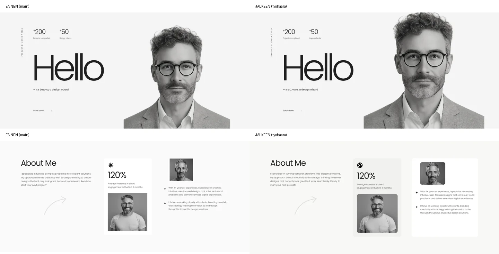
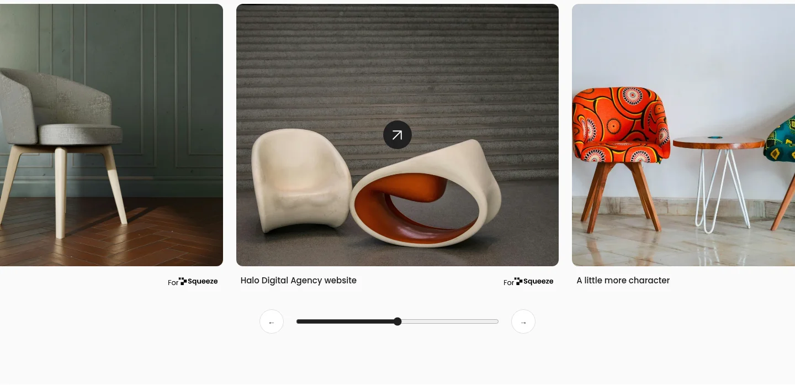

# Viimeistelykierros 11.11.2026

Lähtö: main `17e629c`. Työhaara: `feat/portfolio-final-interactions`. Nykyinen sivurakenne ja mallisisältö säilytettiin. Tämä dokumentti kuvaa uusimman tilanteen; VALIDATION.md:n aiemmat päivämäärät ovat historiaa.

## Toteutetut korjaukset

- Alkuperäiset kolme henkilökuvaa, kalustekuvat ja konsultointikuva korvaavat kuvakaappauksista tehdyt versiot. For Squeeze-, maapallo- ja susitunnukset alkuperäisistä PNG-tiedostoista. Kolmannessa blogissa sohvan sijaan alkuperäinen abstrakti diva-kuva. Täydellinen tiedostokartta: [MATERIALS.md](MATERIALS.md) ja [assets/sources.json](assets/sources.json).
- About Me: erottuva ulompi vaalea tausta, sävytetty 120 % -kortti maapallomerkkeineen, valkoinen oikea sisältökortti, yhtenäiset pyöristykset ja alkuperäisten henkilökuvien rajaukset. Kaareva nuoli säilyy muokattavana SVG:nä.
- Showcase: kaikilla leveyksillä leveä natiivi vaakakaruselli, scroll snap, mobiilin seuraavan kortin reuna, oikeat erilliset logot ja kuvatekstit. Työpöydän aloituksessa keskimmäinen kuva on keskellä. Vierityspalkki, edellinen/seuraava-painikkeet sekä todellista vieritystä seuraava range-kontrolli.
- Hiiren pystyrulla vierittää karusellia vain käytettävissä olevaan suuntaan; reunoissa pystyscroll vapautuu. Natiivi vaakarulla ja trackpad säilyvät. Painikkeiden käytettävyys seuraa reunoja; range toimii näppäimistöllä.
- Hero: enintään 10 px henkilökuvan ja vastakkaissuuntainen 5 px otsikon parallax, requestAnimationFrame, palautus pointerleave/pointercancel-tapahtumilla. Ei efektiä karkealla/hoverittomalla osoittimella. +200/+50 animoituvat kerran 1,5 sekunnissa. Hello-otsikon paljastus säilyttää HTML-tekstin ja asettelun. Reduced motion pysäyttää liikkeen ja näyttää loppuluvut, myös asetuksen vaihtuessa kesken käytön.
- Experiences: natiivi details/summary, yksi avoin rivi, hover/focus-vihje, avoimen rivin tausta, näkyvä plusmerkki ja kevyt sisällön paljastus ilman korkeuskikkoja. Kuvat pyöristetty.
- Winter Deal: yläteksti, koko pääotsikko, annettu kuvausteksti ja Let's talk palautettu erillisiksi HTML-elementeiksi. Tumma kuva/overlay ja mobiiliin mahtuva keskitetty sisältö.
- Latest Works: oikeat For Squeeze -logot, yhtenäiset kuvien pyöristykset ja hover/focus. Nykyiset sisältökuvat säilytettiin, koska referenssin alkuperäiset 3D-kuvat puuttuvat; niiden järjestystä ei väitetä mallin mukaiseksi.
- Blogit: kolme erilaista abstraktia lähdekuvaa; kuvan leikkaava kehys, koko kortin hover/focus-korostus ja toimiva Read insight. Koko kortista ei tehty klikkausaluetta, joten sisäkkäisiä kontrolleja ei synny.

## Testaus

`node tests/browser-check.cjs`, Chromium/Playwright, paikallinen HTTP-palvelin. Leveydet 320, 390, 768, 1024 ja 1440 px (korkeus 900 px).

Kaikilla leveyksillä: kuvat dekoodautuvat, alt ja oikeat width/height ovat olemassa, fontit latautuvat, dokumentissa ei vaakaylivuotoa, karuselli ylittää oman kehyksensä, range toimii Home/End-näppäimillä, Winter Deal -sisältö mahtuu korttiin. Ohituslinkki, mobiilivalikko/Escape, accordion, View More/aria-expanded, blogin avaus ja focus-outline tarkistettu. Pidennetty kapseliteksti mahtuu.

Erilliset toiminnalliset tarkistukset: laskurien välivaihe ja loppuarvot, ei uudelleenkäynnistystä hero-alueelle palatessa, parallaxin liike ja palautus, reduced motion -asetuksen vaihto ajon aikana, hiiren pysty- ja vaakarulla, karusellin molempien reunojen vapauttama sivuscroll sekä koko blogikortin hover. Ilman JavaScriptiä lopulliset luvut/otsikko näkyvät, natiivi karuselli ja blogi toimivat. Kosketuslaitetta jäljittelevässä kontekstissa parallax pysyy pois käytöstä ja valikko aukeaa napauttamalla.

Ei JavaScript-, konsoli- tai verkkopyyntövirheitä testisivulla. Myös `node --check script.js`, testin syntaksi ja `git diff --check` läpäisty.

Kokosivukuvat kaikilta viideltä leveydeltä; osiokuvat 390/768/1440 px, karuselli ja Winter Deal lisäksi 390/1440 px. Visuaalisesti tarkastettiin hero, About, showcase, accordion, CTA, Latest Works, blogi sekä mobiilin ja työpöydän kokosivut. Ei havaittua sivun vaakaylivuotoa tai tekstien/kuvien haitallista päällekkäisyyttä. Kuvakaappaukset eivät yksin osoita alkuperäisen mallin täsmällistä vastaavuutta.

## Ennen / jälkeen

Kuvissa vasen sarake on main `17e629c`, oikea tämän haaran toteutus. Samat 1440 px leveydet, reduced motion. Mobiilikuvassa uusi 390 px toteutus.

[Mobiilin koko sivu](docs/screenshots/page-mobile.webp)

## Malliin jäävät erot ja käyttäjän jäljellä olevat tehtävät

Tämä kierros ei ole täydellinen visuaalinen mallikopio. Showcase/FutureTech-, Latest Works- ja blogireferenssien erilliset 3D/studiokuvitukset puuttuvat. Blogien kolmas kuva on sinivioletti vihreän sijaan; Latest Worksin nykyiset kalustekuvat poikkeavat referenssistä. Winter Deal käyttää aiheeltaan oikeaa mutta erilaista suunnittelukuvaa. Tarkat kuvakohtaiset rajaukset dokumentissa MATERIALS.md.

Koko sivun leiskakuvaa, About Me:n täsmällistä mallikuvaa ja opettajan videoita ei ollut toimituksessa. Repositorion Dribbble-lähdeosoitetta kokeiltiin myös verkosta: HTTP 202 ja tyhjä vastaus, joten kokonaismallia ei voitu sieltäkään avata. Koko sivun mittojen ja videodemojen täsmällistä vastaavuutta ei vahvisteta. Safari/Firefox-, fyysisen kosketuslaitteen ja ruudunlukijan erillistestausta ei tehty.

Käyttäjä tarkistaa PR:n ennen yhdistämistä ja toimittaa puuttuvat alkuperäiset 3D-kuvat/kokonaisleiskan tarkkaa kuvavastaavuutta varten. Figma-mobiiliprototyypin linkki ja palautus ovat edelleen varmistamatta; desktop-proto on lisätavoite. Täydennä COURSE.md:n palautuslinkit ja jäsenet sekä varmista opettajalta määräaika ja palautusmuoto. Tässä työssä ei luotu Figma-tiedostoja eikä vahvistettu sivuston tuotantojulkaisua.
