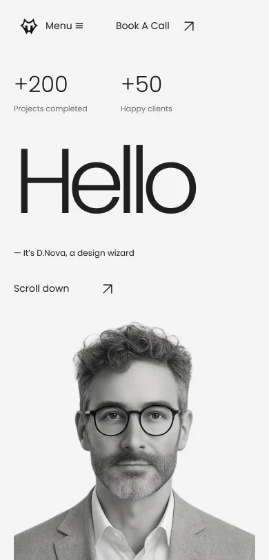
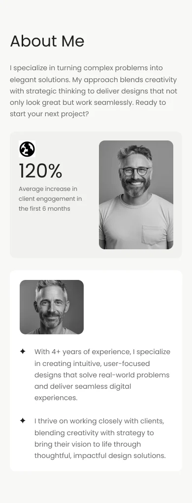

# Muokattava Figma-mobiiliprototyyppi

[Design-tiedosto](https://www.figma.com/design/CAn1NxX7vfOdixPIUFJRV7?node-id=7-87) · [Avaa prototyyppi](https://www.figma.com/proto/CAn1NxX7vfOdixPIUFJRV7?node-id=7-87&starting-point-node-id=7%3A87&scaling=scale-down)

Tiedosto luotiin käyttäjän valitseman SAMK-opiskelijatilin omaan tiimiin 11.11.2026. Pääsivu on `Mobile — Design & prototype`. Prototyypin aloitusframe on **Mobile — Full page**, 390 × 844 px, node `7:87`. Sen sisällä koko sivu on Auto Layout -sisältönä; pystysuuntainen overflow mahdollistaa kaikkien osioiden selaamisen.

## Muokattava rakenne

Erilliset 390 px framet: Hero, About Me, Showcase, Experiences, Winter Deal, Latest Works, Blogs ja Contact / Footer. Lisäksi koko sivun frame ja More works -näkymä. Header on mukana Herossa ja koko sivun alussa. Täysi sivu sisältää 108 muokattavaa tekstikerrosta ja 105 Auto Layout -rakennetta; tekstit käyttävät Poppinsia.

Neljän paikallisen komponenttiperheen variantit: Header Closed/Open, Experience Row Closed/Open, Experience Gallery Row Closed/Open ja Blog Insight Closed/Open. Projektikortti on erillinen uudelleenkäytettävä komponentti. Instanssit säilyttävät muokattavat teksti- ja kuvakerrokset. FutureTechin auki-tilassa on kolme erillistä projektikuvaa.

Valokuvat ja alkuperäiset tunnukset ovat image fill -kuvia; nuolet ovat SVG-vektoreita. Otsikot, painikkeet, kapseli, korttipinnat ja kuvatekstit ovat oikeita Figma-kerroksia. Tiedostoon ei ole tuotu sivun, kortin tai osion kuvakaappausta käyttöliittymäksi. Alkuperäiset kuvat löytyvät erillisestä **Original photos and logos / content assets** -alueesta. Koko sivun UI-kuvia ei käytetty kuvakerroksina.

Verkkosivun automaattinen verkkotuonti estyi ympäristön CONNECT 403 -rajoitukseen. Toteutus rakennettiin siksi Figma Plugin API:lla lähdekoodista; alkuperäiset sisältökuvat vietiin erillisinä kuvatavuina. Figmaan siirrettiin 430 px enimmäismittaan sovitettuja esikatselukuvia; sivuston tarkemmat WebP-jakelukuvat eivät muuttuneet tästä.

## Tyyli- ja layout-suunnitelma

| Kohde | Arvo / toteutus |
| --- | --- |
| Lähtöleveys | 390 px, tavallinen sisäsisältö 350 px |
| Reunavälit | 20 px |
| Tavallinen osion pystysisennys | 64 px; hero 28 px ylhäältä, kuvan alareunaan ei erillistä lisätilaa |
| Palstat | Mobiilissa yksi pääpalsta, 120 % -kortissa kaksi sisäistä palstaa |
| Korttien väli | Tavallisesti 24–32 px; karusellissa 14 px |
| Perusteksti | Poppins Regular 14 px, rivikorkeus 1,65 |
| Pieni teksti / metatieto | 12 / 11 px |
| Otsikko | Poppins Regular 32 px, rivikorkeus 1,18 |
| Hello | Poppins Light 132,6 px / 390 px lähtöleveys, −9 % kirjainväli |
| Laskurit | Poppins Light 32 px |
| Blogiotsikko | Poppins Medium 19 px, rivikorkeus 1,45 |
| Winter Deal | Poppins Medium noin 26 px, rivikorkeus 1,3 |
| Tavallinen pyöristys | 12 px; kapseli 999 px |
| Projektikuva | 350 × 269 px (noin 1,3:1) |
| Heron kuva | 350 × 350 px |
| Karusellikortti | 298 px leveä, seuraavan kortin reuna näkyy |
| Blogikuva | 350 × 226 px prototyypissä; webissä responsiivinen 1,5:1-kehys |

`D.Nova / Tokens` sisältää scoped-muuttujat väreille, väleille ja pyöristyksille. Semanttiset värit viittaavat primitive-arvoihin. WEB-syntaksit vastaavat CSS-muuttujia, esimerkiksi `var(--ink)`, `var(--space-20)` ja `var(--radius-card)`. Käytössä on yhdeksän Poppins-tekstityyliä. Tummalle tilalle ei luotu tarpeettomia lisämoodeja.

| Väri | CSS-muuttuja | Arvo |
| --- | --- | --- |
| Pääteksti | --ink | #202020 |
| Toissijainen teksti | --muted | #686868 |
| Vaalea pinta | --surface | #f4f4f4 |
| Valkoinen | --white | #ffffff |
| Erotin | --line | #dedede |
| Tilastokortti | --surface-card | #f1f1ef |
| About-tausta | --about-background | #f8f8f6 |
| Contact-tausta | --contact-background | #ececec |

## Prototyypin käyttö

Avaa prototyyppilinkki ja aloita D.Nova — Mobile 390 px -flowsta.

- Menu / Close vaihtaa headerin Closed/Open-varianttia.
- About Me, Portfolio, Experience ja Blog vierittävät koko sivun oikeaan osioon.
- Accordionin summary vaihtaa Closed/Open-tilaa; FutureTech käyttää kolmen kuvan varianttiperhettä.
- Showcase-frame vierii vaakasuunnassa, koko sivu pystysuunnassa. Karusellin nuolet on johdotettu ensimmäiseen/viimeiseen korttiin.
- Book A Call ja Let's talk ohjaavat yhteydenottoon tai footerin sähköpostiin.
- Read insight vaihtaa blogikortin avausvarianttia.
- View More navigoi prototyypissä erilliseen More works -näkymään, josta voi palata portfolioon. Varsinaisessa verkkosivussa sama painike avaa lisärivin saman sivun sisään.
- Sähköpostin URL-toiminto käyttää mailto-linkkiä.

Prototyyppi havainnollistaa navigaatiota ja tiloja. Verkkosivun laskurien/parallaxin ajastuksia, scroll-indikaattorin jatkuvaa numeerista tilaa ja accordionin yhden avoimen rivin JavaScript-logiikkaa ei jäljitellä Figma-muuttujakoodilla. Prototyypin accordion-rivit voidaan avata toisistaan riippumatta. Tämä on dokumentoitu prototyypin yksinkertaistus; verkkosivun testattu logiikka säilyy.

## Tarkistus ja rajat

Figma-tiedoston rakenne ja renderöidyt osiokuvat tarkistettiin: tekstit rivittyvät, kuvat näkyvät, component set -alueet mahtuvat sisältöön, alkuperäiskuvien lähteet säilyvät ja jokainen prototype NODE -kohde löytyy. Viimeisessä rakenneauditissa 78 Image-kerrosta (myös komponentit ja erilliset framet), ei puuttuvia image fill -kuvia eikä rikkinäisiä linkkikohteita. Ainoa aloitusflow on koko mobiilisivu.

Esitystilan läpiklikkausta kirjautuneessa Figma-selaimessa ei voitu suorittaa ympäristön Figma-verkkoyhteyden rajoituksen vuoksi. Toiminnot on johdotettu ja niiden kohteet validoitu API:sta; käyttäjän kannattaa vielä käydä prototyyppiflow läpi omassa Figmassaan ja tarkistaa opettajan katseluoikeudet ennen palautusta. Tämä ei ole näyttö kurssipalautuksen lähettämisestä.

